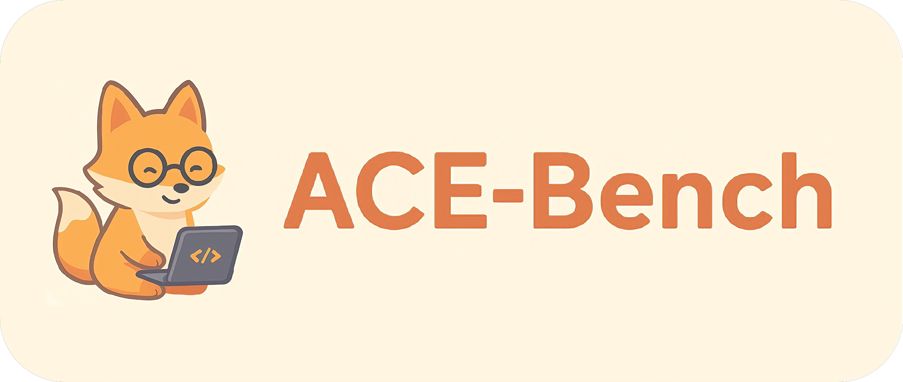

<p align="center">
  
</p>

<p align="center">
  <a href="https://arxiv.org/abs/2602.10975"></a>
  <a href="LICENSE"></a>
  <a href="https://hub.docker.com/u/libercoders"></a>
  <a href="https://huggingface.co/datasets/LiberCoders/FeatureBench"></a>
  <a href="https://libercoders.github.io/FeatureBench/leaderboard/"></a>
</p>

---

FeatureBench combines a feature-level coding benchmark with a fully automated, **Universal Coding
Data Factory**. With one CLI, it continuously discovers GitHub repositories, builds reproducible
environments across languages, and generates validated coding tasks for training and evaluation
through extensible Adapters.

## 📰 News

🏭 **2026.10.30**: We launched a **Universal Coding Data Factory**—fully automated, language-agnostic, and Adapter-driven—to continuously turn GitHub repositories into validated training data for any coding task format.

📈 **2026.10.30**: In internal mixed-task RL experiments using data from our **Universal Coding Data Factory**, Qwen3.8-27B improved SWE-bench Verified Pass@1 from **70.2% to a peak of 79.8%** and FeatureBench 1.1 Tests Passed from **50.3% to a peak of 60.3%**.

📦 **2026.08.24**: We released **FeatureBench Dataset V1.1**, primarily correcting inconsistencies and omissions in task problem statements.

📊 **2026.05.18**: We added **lite split** evaluation results for frontier models including **GPT-5.5, Claude Opus 4.7, DeepSeek-V4, GLM-5.1, Kimi-2.6, Mimo-V2.5-Pro**, and more to the leaderboard.

🚀 **2026.03.27**: We released the **fast split** containing 100 instances (a subset of full split). These instances require no GPU and are optimized for rapid evaluation. On an Intel Xeon Platinum 8457C with 944GB RAM, the average evaluation time per instance using gold patches is **57.2 seconds**.

🎁 **2026.02.06**: We added one-click inference for mainstream agent frameworks, including **OpenHands, Claude Code, Codex, Gemini CLI, and mini-swe-agent**. All supported agent frameworks can be found [here](featurebench/infer/agents/).

<!-- LEADERBOARD_START -->
## 🏆 Leaderboard

[Full interactive leaderboard](https://libercoders.github.io/FeatureBench/leaderboard/) with tabs, filters, and sorting (Dataset V1.0).

<details open>
<summary><b>Lite split results, ranked by %PASSED</b></summary>

| Rank | Model | Scaffold | %PASSED | %RESOLVED |
|---:|---|---|---:|---:|
| 1 | Claude Opus 4.7 | OpenHands | 78.2 | 46.7 |
| 2 | GPT-5.5 | OpenHands | 69.8 | 26.7 |
| 3 | Claude Opus 4.6 | OpenHands | 69.5 | 20 |
| 4 | Claude Opus 4.5 | OpenHands | 67.2 | 20 |
| 5 | GPT-5.4 | OpenHands | 66.2 | 23.3 |
| 6 | GPT-5.1-Codex | Codex | 60.2 | 20 |
| 7 | DeepSeek-V4-Pro | OpenHands | 59.6 | 26.7 |
| 8 | Claude Opus 4.5 | Claude Code | 59.1 | 20 |
| 9 | Kimi-2.6 | OpenHands | 49.4 | 20 |
| 10 | Mimo-V2.5-Pro | OpenHands | 47.8 | 13.3 |
| 11 | Gemini-3-Pro-Preview | OpenHands | 45.1 | 10 |
| 12 | GLM-5.1 | OpenHands | 44.2 | 13.3 |
| 13 | Gemini-3-Pro-Preview | Gemini-CLI | 43.4 | 10 |
| 14 | DeepSeek-V4-Flash | OpenHands | 41.9 | 16.7 |
| 15 | MiniMax M2.1 | Mini-SWE-Agent | 41.9 | 10 |
| 16 | GLM 4.7 | Mini-SWE-Agent | 41.2 | 6.7 |
| 17 | Qwen3-Coder-480B-A35B-Instruct | OpenHands | 38.3 | 6.7 |
| 18 | DeepSeek V3.2 | OpenHands | 35.9 | 6.7 |
| 19 | Qwen3.5-27B | OpenHands | 34.8 | 10.0 |
| 20 | Qwen3-Coder-30B-A3B-Instruct | OpenHands | 23 | 3.3 |

</details>
<!-- LEADERBOARD_END -->

## 🚀 Quickstart

**Prerequisites:**

- Python 3.12 or later
- [Docker](https://docs.docker.com/engine/install/) for reproducible builds and evaluation
- [uv](https://docs.astral.sh/uv/getting-started/installation/) when using uv or installing from source

```bash
# Install from PyPI
pip install featurebench

# Or install the CLI with uv
uv tool install featurebench

# Install from source
git clone https://github.com/LiberCoders/FeatureBench.git
cd FeatureBench
uv sync
source .venv/bin/activate
```

Create `config.toml` from [config_example.toml](config_example.toml). From a source checkout:

```bash
cp config_example.toml config.toml
```

Optionally pre-pull the benchmark images:

```bash
fb pull --mode fast
```

Run inference:

```bash
fb infer \
    --config-path config.toml \
    --data-version v1.1 \
    --agent mini_swe_agent \
    --model openai/qwen3-coder-480b-a35b-instruct \
    --split fast
```

Evaluate the generated patches:

```bash
fb eval \
    -p runs/<timestamp>/output.jsonl \
    --split fast
```

## 🏭 Universal Coding Data Factory

The factory automatically discovers GitHub repositories, builds reproducible environments, and
generates validated coding tasks. Adapters define the task format; FeatureBench is included by
default. This workflow is optional for benchmark users.

Put provider credentials in `.env`. From a source checkout:

```bash
cp .env.example .env
```

The default settings work out of the box and can be customized through
`configs/default/*.yaml` or `--config`.

```bash
fb discover
fb build outputs/discover-YYYYMMDD-HHMMSS/repositories.jsonl
fb generate outputs/build-YYYYMMDD-HHMMSS/environments.jsonl \
  --adapter featurebench
```

## 🧭 CLI

**Benchmark:**

- `fb infer` runs coding agents on FeatureBench tasks ([Documentation](docs/infer.md)).
- `fb eval` evaluates generated patches ([Documentation](docs/eval.md)).
- `fb pull` pre-pulls benchmark Docker images ([Documentation](docs/pull.md)).

**Data factory:**

- `fb discover` finds candidate GitHub repositories ([Documentation](docs/discover.md)).
- `fb build` creates reusable, validated environments ([Documentation](docs/build.md)).
- `fb generate` generates tasks through an Adapter ([Documentation](docs/generate.md)).
- `fb configure` edits an inactive run before resuming it
  ([Documentation](docs/configure.md)).
- `fb --resume` continues an interrupted run ([Documentation](docs/reference/resume.md)).

## ✍️ Citation

If you found FeatureBench useful, please cite us as:

```bibtex
@article{zhou2026featurebench,
  title={FeatureBench: Benchmarking Agentic Coding for Complex Feature Development},
  author={Zhou, Qixing and Zhang, Jiacheng and Wang, Haiyang and Hao, Rui and Wang, Jiahe and Han, Minghao and Yang, Yuxue and Wu, Shuzhe and Pan, Feiyang and Fan, Lue and others},
  journal={arXiv preprint arXiv:2602.10975},
  year={2026}
}
```

## 📧 Contact

If you have any questions, feel free to contact [qixing.zhou@smail.nju.edu.cn](mailto:qixing.zhou@smail.nju.edu.cn) or [zjcheng2022@gmail.com](mailto:zjcheng2022@gmail.com).
